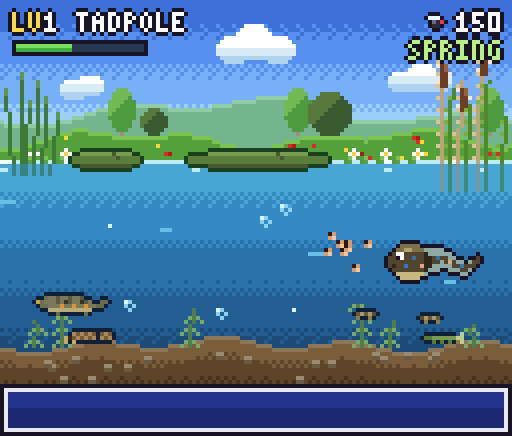
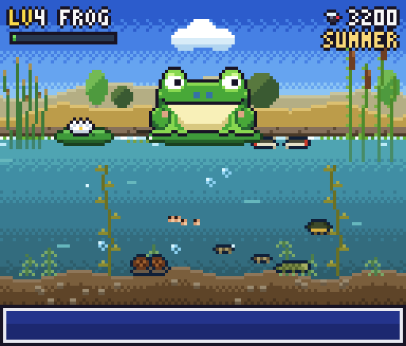
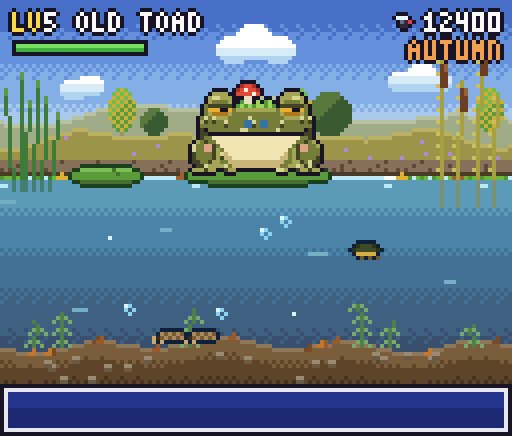
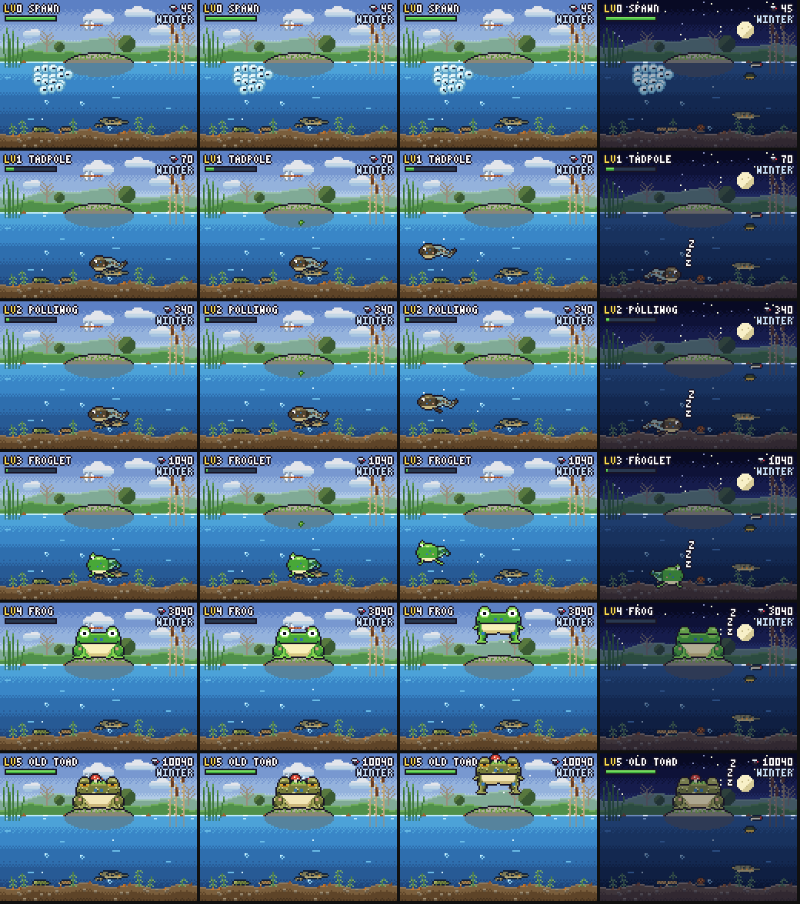
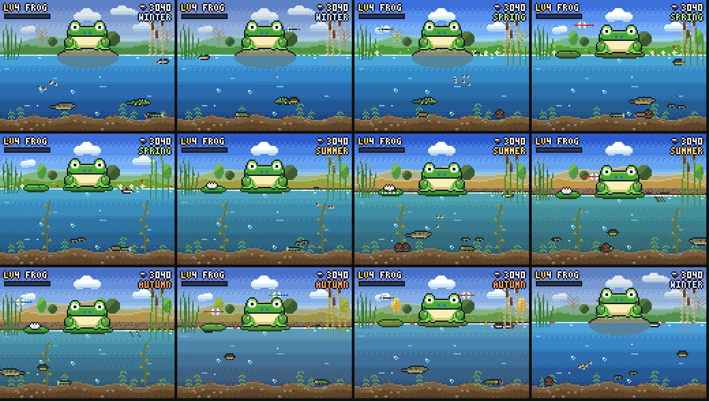

# git-toad

A 16-bit pond toad that grows out of your GitHub contributions. It starts as a clump of frogspawn and, commit by commit, becomes a tadpole, sprouts legs, crawls out as a froglet, and grows into a warty old toad with a mushroom sprouting from its head.

<p>
  
  
  
</p>

Inspired by [git-koi](https://github.com/yalongwastaken/git-koi).

## How your toad lives

**Total contributions grow it.**

| Level | Stage     | Contributions |
| ----- | --------- | ------------- |
| 0     | Spawn     | 0             |
| 1     | Tadpole   | 30            |
| 2     | Polliwog  | 300           |
| 3     | Froglet   | 1,000         |
| 4     | Frog      | 3,000         |
| 5     | Old Toad  | 10,000        |

The HUD shows the level, an XP bar toward the next stage, and your total contribution count.

**Streaks spot it.** Every 7 days of your longest daily streak unlocks a pair of spots (up to 3 pairs). The spots take the colors of your top three languages.

**Yesterday decides what it does.** The scene is rendered from the day that just ended (UTC):

| Behavior | When                                                                     | What you see                                                     |
| -------- | ------------------------------------------------------------------------ | ---------------------------------------------------------------- |
| `sleep`  | 14+ quiet days in a row                                                  | Night falls; the toad dozes and snores Z's.                      |
| `leap`   | Crossed a milestone or a new stage in the last 7 days, or had a top-10% day | Jumps off its perch (tadpoles dart around) with sparkles.     |
| `hunt`   | Contributed yesterday                                                    | Catches a fly with its tongue (tadpoles chase a food flake).     |
| `idle`   | Otherwise                                                                | Blinks, looks around, and croaks.                                |



## The pond through the year

The pond is a fishless, semi-permanent Mediterranean pond, the kind amphibians breed in. It follows the calendar of lowland southern Europe for the day being drawn, and its inhabitants are reshuffled every day.



- **Banks** are green through the rainy winter and spring, with crown daisies and corn poppies in spring. They turn golden in the summer drought and green up after the autumn rains, when autumn squill flowers.
- **Water** is clear in winter, greener with phytoplankton in summer, and tea-colored with leaf tannins in autumn. In the dry season it drops and exposes cracked mud.
- **Trees:** holm oaks stay evergreen. White poplars bud in March, turn in October, go gold in November, and are bare in winter.
- **Reedmace** (*Typha*) goes from dead straw with fluffy seed heads in winter, to new shoots in spring, to pollen spikes in June and brown seed heads in late summer. **Rushes** (*Juncus*) stay green all year.
- **Water plants:**
  - Pond water-crowfoot (*Ranunculus peltatus*) has floating leaves from February and white flowers in spring.
  - White water lily (*Nymphaea alba*) has pads from April to November and flowers from June to September. Outside that season the frog sits on a mossy rock.
  - Pondweed (*Potamogeton*) grows in the warm months, stoneworts (*Chara*) carpet the bottom all year, and duckweed and algae appear in summer.
- **Leaves** float on the surface in autumn and rot on the bottom over winter.

**Animals** are picked each day from the species active that month, weighted by abundance:

| Where | Species |
| ----- | ------- |
| Air | Iberian bluetail (*Ischnura graellsii*), emperor dragonfly (*Anax imperator*), scarlet darter (*Crocothemis erythraea*), common darter (*Sympetrum striolatum*). Not at night. |
| Surface | Pond skater (*Gerris lacustris*), mosquito larvae (*Culex pipiens*), backswimmer (*Notonecta glauca*) |
| Open water | Great diving beetle (*Dytiscus circumflexus*), lesser water boatman (*Sigara*), water fleas (*Daphnia magna*), marbled newt (*Triturus marmoratus*, in its breeding crest from November to May), Iberian ribbed newt (*Pleurodeles waltl*, with its orange rib warts) |
| Bottom | Caddisfly larva (Limnephilidae), dragonfly and damselfly nymphs, great ramshorn snail (*Planorbarius corneus*) |

There are no fish, because fish-free ponds are the ones that keep amphibians. In practice the fish would be the invasive mosquitofish, *Gambusia holbrooki*, which eats tadpoles. There are also no *Triops* or fairy shrimps, which need ponds that dry out completely every summer.

Each render also writes `pond.json`, listing the species in that day's pond.

## Add it to your profile

1. In your profile repository (`github.com/<you>/<you>`), copy [examples/profile-workflow.yml](examples/profile-workflow.yml) to `.github/workflows/toad.yml`. It uses `Calotriton/git-toad@main`.
2. Add the toad to your profile `README.md`:
   ```markdown
   
   ```
3. Run the workflow once from the Actions tab. After that it updates every night.

Action inputs:

| Input        | Default                 | Notes                                          |
| ------------ | ----------------------- | ---------------------------------------------- |
| `login`      | repository owner        | Whose public activity grows the toad.          |
| `skin`       | `meadow`                | `meadow`, `golden`, `azure`, `crimson`, `violet` |
| `output-dir` | `toad`                  | Gets `toad.gif` (animated), `toad.png` (still) and `pond.json` (today's species). |
| `scale`      | `4`                     | The scene is 128x96 pixels; 4 gives 512x384.   |
| `token`      | `github.token`          | Only public data is read.                      |

## Run it locally

You need Python 3.9 or newer. There are no other dependencies: the GIF and PNG encoders are built in.

```sh
export GITHUB_TOKEN=...            # any token; only public data is read
python -m gittoad collect octocat --output snapshot.json
python -m gittoad render snapshot.json --output-dir toad --skin azure
```

Preview any stage or behavior without waiting for it:

```sh
python -m gittoad render snapshot.json --stage 3 --behavior leap
python -m gittoad render snapshot.json --date 2026-04-20     # the pond on any day of the year
python -m gittoad demo --gifs      # every stage x behavior, plus demo/sheet.png
python -m gittoad demo --seasons   # one frame per month
```

Run the tests with `python -m unittest discover -s tests`.

## How it is made

- `gittoad/collect.py` reads your contribution calendar and repository languages from the GitHub GraphQL API.
- `gittoad/life.py` turns that snapshot into a stage, spots and a behavior.
- `gittoad/pond.py` holds the ecology: monthly phenology of the plants, banks and water, and the species list with abundances and sprites.
- `gittoad/art.py` paints the pond on a 128x96 canvas: banded, Bayer-dithered sky and water gradients, hand-made sprite templates for the frog (mirrored, auto-outlined), procedurally animated tadpole tails, and a 3x5 bitmap HUD font.
- `gittoad/encode.py` writes the looping GIF with its own LZW encoder. It only re-encodes the parts of each frame that changed.
